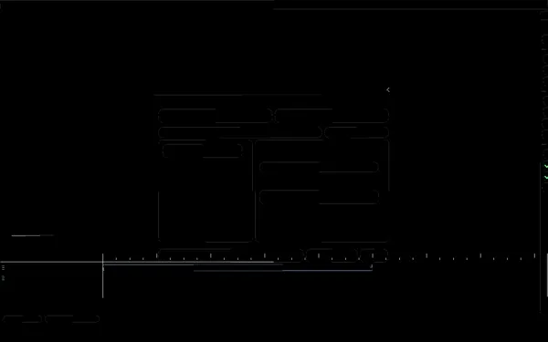
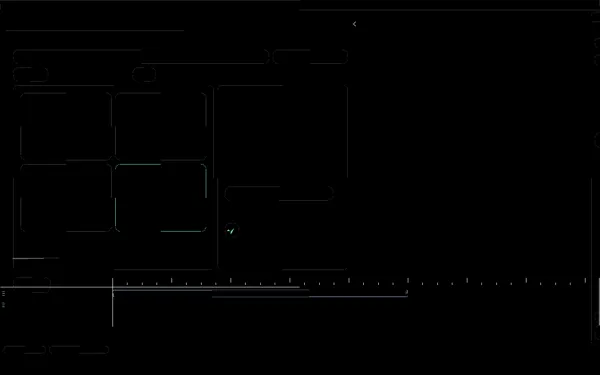
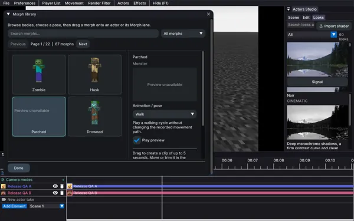
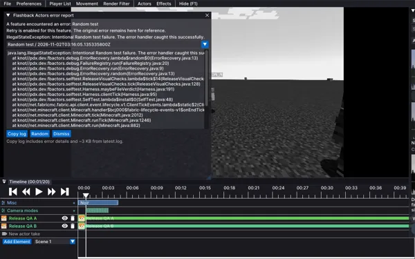
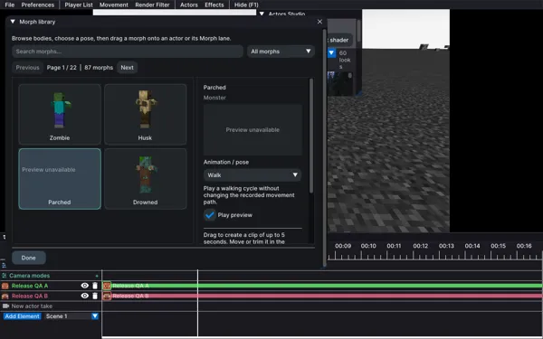
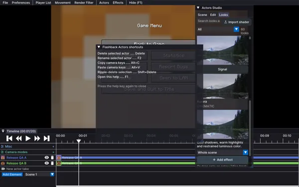

# Failed attempts

20 saved failed or errored attempts. Later passes are retained separately.

## Client run / 26.3

**ERROR** · 2026-11-02T06:07:42.469204+00:00 · `morph-isolation-world`

1 visual check(s) flagged. Client verdict: ERROR. Client exited without a saved verdict. See the failure context below.

A later native-menu-queue run passed. This earlier attempt remains failed.

- **ERROR** Client harness: 
- **FAILED** Visual checks: 0 captures; 0 animation pairs; 1 flags.

### Recorded visual flags

- No completed screenshot manifest

### Failure context

```text
replay : <checkout>\build\release-batches\morph-isolation-world\26.3\fixture.zip
client : booting 26.3 (launcher pid 6444) -- watch the window.
client closed.
Client launcher exited (); see 
<checkout>\build\release-batches\morph-isolation-world\26.3/gradle.log
At <checkout>\tools\harness.ps1:99 char:32
+ ... asExited) { throw "Client launcher exited ($($proc.ExitCode)); see $A ...
+                 ~~~~~~~~~~~~~~~~~~~~~~~~~~~~~~~~~~~~~~~~~~~~~~~~~~~~~~~~~
    + CategoryInfo          : OperationStopped: (Client launcher...26.3/gradle.log:String) [], RuntimeException
    + FullyQualifiedErrorId : Client launcher exited (); see <checkout>\bui 
   ld\release-batches\morph-isolation-world\26.3/gradle.log
```

## Client run / 26.3

**ERROR** · 2026-11-02T06:02:58.677808+00:00 · `morph-isolation`

1 visual check(s) flagged. Client verdict: ERROR. Client exited without a saved verdict. See the failure context below.

A later native-menu-queue run passed. This earlier attempt remains failed.

- **ERROR** Client harness: 
- **FAILED** Visual checks: 0 captures; 0 animation pairs; 1 flags.

### Recorded visual flags

- No completed screenshot manifest

### Failure context

```text
replay : <checkout>\build\release-batches\morph-isolation\26.3\fixture.zip
client : booting 26.3 (launcher pid 37264) -- watch the window.
client closed.
Client launcher exited (); see 
<checkout>\build\release-batches\morph-isolation\26.3/gradle.log
At <checkout>\tools\harness.ps1:99 char:32
+ ... asExited) { throw "Client launcher exited ($($proc.ExitCode)); see $A ...
+                 ~~~~~~~~~~~~~~~~~~~~~~~~~~~~~~~~~~~~~~~~~~~~~~~~~~~~~~~~~
    + CategoryInfo          : OperationStopped: (Client launcher...26.3/gradle.log:String) [], RuntimeException
    + FullyQualifiedErrorId : Client launcher exited (); see <checkout>\bui 
   ld\release-batches\morph-isolation\26.3/gradle.log
```

## Client run / 26.2

**ERROR** · 2026-11-02T06:02:29.295943+00:00 · `morph-isolation`

1 visual check(s) flagged. Client verdict: ERROR. Client exited without a saved verdict. See the failure context below.

A later morph-isolation-world run passed. This earlier attempt remains failed.

- **ERROR** Client harness: 
- **FAILED** Visual checks: 0 captures; 0 animation pairs; 1 flags.

### Recorded visual flags

- No completed screenshot manifest

### Failure context

```text
replay : <checkout>\build\release-batches\morph-isolation\26.2\fixture.zip
client : booting 26.2 (launcher pid 4588) -- watch the window.
client closed.
Client launcher exited (); see 
<checkout>\build\release-batches\morph-isolation\26.2/gradle.log
At <checkout>\tools\harness.ps1:99 char:32
+ ... asExited) { throw "Client launcher exited ($($proc.ExitCode)); see $A ...
+                 ~~~~~~~~~~~~~~~~~~~~~~~~~~~~~~~~~~~~~~~~~~~~~~~~~~~~~~~~~
    + CategoryInfo          : OperationStopped: (Client launcher...26.2/gradle.log:String) [], RuntimeException
    + FullyQualifiedErrorId : Client launcher exited (); see <checkout>\bui 
   ld\release-batches\morph-isolation\26.2/gradle.log
```

## Release validation final

**FAILED** · 2026-11-02T04:13:27.525834+00:00 · `release-validation-final.log`

BUILD FAILED. Compiler/build failure context is preserved below.

A later release-validation-complete.log run passed. This earlier attempt remains failed.


### Failure context

```text
<checkout>\src\test\java\pdx\dev\fbactors\actor\CombatPlaybackTest.java:5: error: cannot find symbol
<checkout>\src\test\java\pdx\dev\fbactors\actor\TerrainEditsTest.java:9: error: package TerrainEdits does not exist
<checkout>\src\test\java\pdx\dev\fbactors\camera\BoatBattleCameraTest.java:25: error: package BoatCameraModel does not exist
<checkout>\src\test\java\pdx\dev\fbactors\camera\BoatCameraModelTest.java:7: error: package BoatCameraModel does not exist
<checkout>\src\test\java\pdx\dev\fbactors\camera\BoatCameraModelTest.java:56: error: cannot find symbol
<checkout>\src\test\java\pdx\dev\fbactors\camera\BoatTimelineTest.java:9: error: package BoatTimeline does not exist
<checkout>\src\test\java\pdx\dev\fbactors\camera\CameraExportTest.java:8: error: package BoatTimeline does not exist
<checkout>\src\test\java\pdx\dev\fbactors\camera\CameraModesTest.java:8: error: package BoatCam does not exist
<checkout>\src\test\java\pdx\dev\fbactors\camera\CameraPreviewBudgetTest.java:32: error: package CameraPreviewMesh does not exist
<checkout>\src\test\java\pdx\dev\fbactors\camera\CameraPreviewBudgetTest.java:32: error: package CameraPreviewMesh does not exist
<checkout>\src\test\java\pdx\dev\fbactors\camera\CinematicCameraTest.java:7: error: package BoatCameraModel does not exist
<checkout>\src\test\java\pdx\dev\fbactors\convert\ConversionSupportTest.java:9: error: package McprReader does not exist
<checkout>\src\test\java\pdx\dev\fbactors\convert\McprProtocolStreamTest.java:10: error: package McprReader does not exist
<checkout>\src\test\java\pdx\dev\fbactors\convert\McprReplayPacketsTest.java:7: error: cannot find symbol
<checkout>\src\test\java\pdx\dev\fbactors\emote\EmoteStanceTest.java:11: error: cannot find symbol
```

## ReplayMod import / 26.2

**FAILED** · 2026-11-02T04:02:23.461695+00:00 · `conversion-final`

Invalid or unsupported ReplayMod protocol stream: Unsupported custom payload minecraft:register; no replay was written

A later conversion-final-2 run passed. This earlier attempt remains failed.

- **FAILED** Client harness: Invalid or unsupported ReplayMod protocol stream: Unsupported custom payload minecraft:register; no replay was written

## ReplayMod import / 26.2

**ERROR** · 2026-11-02T03:57:19.149000+00:00 · `conversion-check-4`

Self-test could not start here.

A later conversion-final-2 run passed. This earlier attempt remains failed.

- **ERROR** Client harness: Self-test could not start here.

## ReplayMod import / 26.2

**ERROR** · 2026-11-02T03:55:15.580855+00:00 · `conversion-check-3`

Self-test could not start here.

A later conversion-final-2 run passed. This earlier attempt remains failed.

- **ERROR** Client harness: Self-test could not start here.

## ReplayMod import / 26.2

**FAILED** · 2026-11-02T03:51:19.968981+00:00 · `conversion-check-2`

Self-test FAIL (5 problem(s)).

A later conversion-final-2 run passed. This earlier attempt remains failed.

- **FAILED** Client harness: Self-test FAIL (5 problem(s)).

## ReplayMod import / 26.2

**ERROR** · 2026-11-02T03:45:23.425606+00:00 · `conversion-check`

Client exited without a saved verdict. See the failure context below.

A later conversion-final-2 run passed. This earlier attempt remains failed.

- **ERROR** Client harness: 

### Failure context

```text
com.moulberry.flashback.exception.UnsupportedPacketException: Packet minecraft:ping is not supported
	at knot//com.moulberry.flashback.playback.ReplayConfigurationPacketHandler.handlePing(ReplayConfigurationPacketHandler.java:301)
	at knot//net.minecraft.network.protocol.common.ClientboundPingPacket.handle(ClientboundPingPacket.java:33)
	at knot//net.minecraft.network.protocol.common.ClientboundPingPacket.handle(ClientboundPingPacket.java:9)
	at knot//com.moulberry.flashback.playback.ReplayServer.handleConfigurationPacket(ReplayServer.java:662)
	at knot//com.moulberry.flashback.action.ActionConfigurationPacket.handle(ActionConfigurationPacket.java:22)
	at knot//com.moulberry.flashback.io.ReplayReader.handleSnapshot(ReplayReader.java:96)
	at knot//com.moulberry.flashback.playback.ReplayServer.tickServer(ReplayServer.java:915)
	at knot//net.minecraft.server.MinecraftServer.processPacketsAndTick(MinecraftServer.java:1034)
	at knot//net.minecraft.client.server.IntegratedServer.processPacketsAndTick(IntegratedServer.java:107)
	at knot//net.minecraft.server.MinecraftServer.runServer(MinecraftServer.java:773)
	at knot//net.minecraft.server.MinecraftServer.lambda$spin$0(MinecraftServer.java:320)
	at java.base/java.lang.Thread.run(Thread.java:1474)
[20:45:21] [Server thread/WARN] (Minecraft) Failed to get system info for Process Loads

java.lang.NullPointerException: Cannot invoke "oshi.software.os.OSProcess.getUserTime()" because "process" is null
	at knot//net.minecraft.SystemReport.lambda$putProcessDetails$0(SystemReport.java:190)
	at knot//net.minecraft.SystemReport.setDetail(SystemReport.java:9
```

## Client run / 26.2

**FAILED** · 2026-11-02T03:38:40.522325+00:00 · `production-check-3`

130 visual check(s) flagged. Client verdict: PASS. Self-test PASS (3 actors, 163 ticks).

A later morph-isolation-world run passed. This earlier attempt remains failed.

- **PASSED** Client harness: Self-test PASS (3 actors, 163 ticks).
- **PASSED** Recording and sharing: PASS: setup, countdown, movement, crouch/sprint inputs, item use deduplication, stop, binary take and sharing bundle roundtrips
- **PASSED** Camera export: PASS: real MP4 export, nonzero start tick, all 14 modes reached accurate camera position
- **FAILED** Visual checks: 125 captures; 18 animation pairs; 130 flags.
- **PASSED** Error window: copy log: Clipboard readback characters=4122
Copied error details and recent log to clipboard.
- **PASSED** Decoded video: h264; 640 x 360; 55 frames.

### Recorded visual flags

- actor-morph-picker: empty or unreadable frame
- morph-cat-idle: empty or unreadable frame
- morph-cat-idle: empty inspector preview
- morph-cat-standing: empty or unreadable frame
- morph-cat-standing: empty inspector preview
- morph-cat-walking: empty or unreadable frame
- morph-cat-walking: empty inspector preview
- morph-cat-walking: preview did not animate between captures
- morph-cat-running: empty or unreadable frame
- morph-cat-running: empty inspector preview
- morph-cat-running: preview did not animate between captures
- morph-cat-sitting: empty or unreadable frame
- morph-cat-sitting: empty inspector preview
- morph-cat-relaxing: empty or unreadable frame
- morph-cat-relaxing: empty inspector preview
- morph-wolf-auto: empty or unreadable frame
- morph-wolf-auto: empty inspector preview
- morph-wolf-idle: empty or unreadable frame
- morph-wolf-idle: empty inspector preview
- morph-wolf-standing: empty or unreadable frame
- morph-wolf-standing: empty inspector preview
- morph-wolf-walking: empty or unreadable frame
- morph-wolf-walking: empty inspector preview
- morph-wolf-sitting: empty or unreadable frame
- morph-wolf-sitting: empty inspector preview
- morph-parrot-auto: empty or unreadable frame
- morph-parrot-auto: empty inspector preview
- morph-parrot-idle: empty or unreadable frame
- morph-parrot-idle: empty inspector preview
- morph-parrot-standing: empty or unreadable frame
- morph-parrot-standing: empty inspector preview
- morph-parrot-walking: empty or unreadable frame
- morph-parrot-walking: empty inspector preview
- morph-parrot-walking: preview did not animate between captures
- morph-parrot-running: empty or unreadable frame
- morph-parrot-running: empty inspector preview
- morph-parrot-running: preview did not animate between captures
- morph-parrot-sitting: empty or unreadable frame
- morph-parrot-sitting: empty inspector preview
- morph-zombie-auto: empty or unreadable frame
- morph-zombie-auto: empty inspector preview
- morph-zombie-idle: empty or unreadable frame
- morph-zombie-idle: empty inspector preview
- morph-zombie-standing: empty or unreadable frame
- morph-zombie-standing: empty inspector preview
- morph-zombie-walking: empty or unreadable frame
- morph-zombie-walking: empty inspector preview
- morph-zombie-walking: preview did not animate between captures
- morph-zombie-running: empty or unreadable frame
- morph-zombie-running: empty inspector preview
- morph-zombie-running: preview did not animate between captures
- morph-zombie-crouching: empty or unreadable frame
- morph-zombie-crouching: empty inspector preview
- morph-zombie-sitting: empty or unreadable frame
- morph-zombie-sitting: empty inspector preview
- morph-husk-auto: empty or unreadable frame
- morph-husk-auto: empty inspector preview
- morph-husk-idle: empty or unreadable frame
- morph-husk-idle: empty inspector preview
- morph-husk-standing: empty or unreadable frame
- morph-husk-standing: empty inspector preview
- morph-husk-walking: empty or unreadable frame
- morph-husk-walking: empty inspector preview
- morph-husk-running: empty or unreadable frame
- morph-husk-running: empty inspector preview
- morph-husk-crouching: empty or unreadable frame
- morph-husk-crouching: empty inspector preview
- morph-husk-sitting: empty or unreadable frame
- morph-husk-sitting: empty inspector preview
- morph-parched-auto: empty or unreadable frame
- morph-parched-auto: empty inspector preview
- morph-parched-idle: empty or unreadable frame
- morph-parched-idle: empty inspector preview
- morph-parched-standing: empty or unreadable frame
- morph-parched-standing: empty inspector preview
- morph-parched-walking: empty or unreadable frame
- morph-parched-walking: empty inspector preview
- morph-parched-running: empty or unreadable frame
- morph-parched-running: empty inspector preview
- morph-parched-crouching: empty or unreadable frame
- morph-parched-crouching: empty inspector preview
- morph-parched-sitting: empty or unreadable frame
- morph-parched-sitting: empty inspector preview
- morph-drowned-auto: empty or unreadable frame
- morph-drowned-auto: empty inspector preview
- morph-drowned-idle: empty or unreadable frame
- morph-drowned-idle: empty inspector preview
- morph-drowned-walking: empty or unreadable frame
- morph-drowned-walking: empty inspector preview
- morph-drowned-walking: preview did not animate between captures
- morph-drowned-running: empty or unreadable frame
- morph-drowned-running: empty inspector preview
- morph-drowned-running: preview did not animate between captures
- morph-drowned-crouching: empty or unreadable frame
- morph-drowned-crouching: empty inspector preview
- morph-drowned-sitting: empty or unreadable frame
- morph-drowned-sitting: empty inspector preview
- morph-skeleton-auto: empty or unreadable frame
- morph-skeleton-auto: empty inspector preview
- morph-skeleton-standing: empty or unreadable frame
- morph-skeleton-standing: empty inspector preview
- morph-skeleton-walking: empty or unreadable frame
- morph-skeleton-walking: empty inspector preview
- morph-skeleton-walking: preview did not animate between captures
- morph-skeleton-running: empty or unreadable frame
- morph-skeleton-running: empty inspector preview
- morph-skeleton-running: preview did not animate between captures
- morph-skeleton-crouching: empty or unreadable frame
- morph-skeleton-crouching: empty inspector preview
- morph-skeleton-sitting: empty or unreadable frame
- morph-skeleton-sitting: empty inspector preview
- morph-piglin-auto: empty or unreadable frame
- morph-piglin-auto: empty inspector preview
- morph-piglin-idle: empty or unreadable frame
- morph-piglin-idle: empty inspector preview
- morph-piglin-standing: empty or unreadable frame
- morph-piglin-standing: empty inspector preview
- morph-piglin-sitting: empty or unreadable frame
- morph-piglin-sitting: empty inspector preview
- morph-catalog-0: empty or unreadable frame
- morph-catalog-1: empty or unreadable frame
- morph-catalog-2: empty or unreadable frame
- morph-catalog-3: empty or unreadable frame
- morph-catalog-5: empty or unreadable frame
- morph-catalog-6: empty or unreadable frame
- morph-catalog-7: empty or unreadable frame
- morph-catalog-11: empty or unreadable frame
- morph-catalog-16: empty or unreadable frame
- morph-catalog-18: empty or unreadable frame
- morph-catalog-19: empty or unreadable frame

### Failure context

```text
=0.00m poseMisses=0 entryMisses=0 nameMisses=0 gearMisses=0 helmetMisses=0 emoteMisses=0 respawns=0 divergedTicks=0
- SelfTest walk: sampled=1200 maxGap=0.00m poseMisses=0 entryMisses=0 nameMisses=0 gearMisses=0 helmetMisses=0 emoteMisses=0 respawns=0 divergedTicks=0
- SelfTest fly-pose: sampled=1200 maxGap=0.00m poseMisses=0 entryMisses=0 nameMisses=0 gearMisses=0 helmetMisses=0 emoteMisses=0 respawns=0 divergedTicks=0
aborted: timed out

=== self-test 2026-11-01T20:20:52.5683748 replay=872300f5-f8f6-481e-8af1-b83fe26a9b55 ===
fbactors self-test: Self-test PASS (3 actors, 163 ticks).
replay=872300f5-f8f6-481e-8af1-b83fe26a9b55 morphs=on
- SelfTest stand: sampled=163 maxGap=0.00m poseMisses=0 entryMisses=0 nameMisses=0 gearMisses=0 helmetMisses=0 emoteMisses=0 respawns=0 divergedTicks=0
- SelfTest walk: sampled=163 maxGap=0.00m poseMisses=0 entryMisses=0 nameMisses=0 gearMisses=0 helmetMisses=0 emoteMisses=0 respawns=0 divergedTicks=0
- SelfTest fly-pose: sampled=163 maxGap=0.00m poseMisses=0 entryMisses=0 nameMisses=0 gearMisses=0 helmetMisses=0 emoteMisses=0 respawns=0 divergedTicks=0

=== self-test 2026-11-01T20:36:34.6647498 replay=45c7b782-89b6-409a-af87-a7b16f2cb3f7 ===
fbactors self-test: Self-test PASS (3 actors, 163 ticks).
replay=45c7b782-89b6-409a-af87-a7b16f2cb3f7 morphs=on
- SelfTest stand: sampled=163 maxGap=0.00m poseMisses=0 entryMisses=0 nameMisses=0 gearMisses=0 helmetMisses=0 emoteMisses=0 respawns=0 divergedTicks=0
- SelfTest walk: sampled=163 maxGap=0.00m poseMisses=0 entryMisses=0 nameMisses=0 gearMisses=0 helmetMisses=0 emoteMisses=0 respawns=0 divergedTicks=0
- SelfTest fly-pose: sampled=163 maxGap=0.00m poseMisses=0 entryMisses=0 nameMisses=0 gearMisses=0 helmetMisses=0 emoteMisses=0 respawns=0 divergedTicks=0

client closed.
```




## Client run / 1.21.8

**ERROR** · 2026-11-02T03:31:17.549351+00:00 · `production-check-3`

1 visual check(s) flagged. Client verdict: ERROR. Client exited without a saved verdict. See the failure context below.

A later render-repair run passed. This earlier attempt remains failed.

- **ERROR** Client harness: 
- **FAILED** Visual checks: 0 captures; 0 animation pairs; 1 flags.

### Recorded visual flags

- No completed screenshot manifest

### Failure context

```text
java.util.ConcurrentModificationException: null
	at java.base/java.util.ArrayList$ArrayListSpliterator.forEachRemaining(ArrayList.java:1714) ~[?:?]
	at java.base/java.util.stream.AbstractPipeline.copyInto(AbstractPipeline.java:509) ~[?:?]
	at java.base/java.util.stream.AbstractPipeline.wrapAndCopyInto(AbstractPipeline.java:499) ~[?:?]
	at java.base/java.util.stream.ReduceOps$ReduceOp.evaluateSequential(ReduceOps.java:921) ~[?:?]
	at java.base/java.util.stream.ReduceOps$5.evaluateSequential(ReduceOps.java:258) ~[?:?]
	at java.base/java.util.stream.ReduceOps$5.evaluateSequential(ReduceOps.java:248) ~[?:?]
	at java.base/java.util.stream.AbstractPipeline.evaluate(AbstractPipeline.java:234) ~[?:?]
	at java.base/java.util.stream.ReferencePipeline.count(ReferencePipeline.java:709) ~[?:?]
	at knot/com.moulberry.flashback.editor.ui.windows.TimelineWindow.localvar$zhp000$fbactors$includeActorRows(TimelineWindow.java:2390) ~[flashback-0.39.10-64b5720b4b825f21.jar:?]
	at knot/com.moulberry.flashback.editor.ui.windows.TimelineWindow.renderInner(TimelineWindow.java:205) ~[flashback-0.39.10-64b5720b4b825f21.jar:?]
	at knot/com.moulberry.flashback.editor.ui.windows.TimelineWindow.render(TimelineWindow.java:174) ~[flashback-0.39.10-64b5720b4b825f21.jar:?]
	at knot/com.moulberry.flashback.editor.ui.ReplayUI.drawOverlayInternal(ReplayUI.java:876) ~[flashback-0.39.10-64b5720b4b825f21.jar:?]
	at knot/com.moulberry.flashback.editor.ui.ReplayUI.drawOverlay(ReplayUI.java:541) ~[flashback-0.39.10-64b5720b4b825f21.jar:?]
	at knot/net.minecraft.client.Minecraft.handler$zcf000$flashback$afterMainB
```

## Client run / 26.2

**FAILED** · 2026-11-02T03:22:49.633765+00:00 · `production-check-2`

71 visual check(s) flagged. Client verdict: PASS. Self-test PASS (3 actors, 163 ticks).

A later morph-isolation-world run passed. This earlier attempt remains failed.

- **PASSED** Client harness: Self-test PASS (3 actors, 163 ticks).
- **PASSED** Recording and sharing: PASS: setup, countdown, movement, crouch/sprint inputs, item use deduplication, stop, binary take and sharing bundle roundtrips
- **PASSED** Camera export: PASS: real MP4 export, nonzero start tick, all 14 modes reached accurate camera position
- **FAILED** Visual checks: 125 captures; 18 animation pairs; 71 flags.
- **PASSED** Error window: copy log: Clipboard readback characters=4122
Copied error details and recent log to clipboard.
- **PASSED** Decoded video: h264; 640 x 360; 55 frames.

### Recorded visual flags

- morph-cat-auto: empty inspector preview
- morph-cat-idle: empty inspector preview
- morph-cat-standing: empty inspector preview
- morph-cat-walking: empty inspector preview
- morph-cat-walking: preview did not animate between captures
- morph-cat-running: empty inspector preview
- morph-cat-running: preview did not animate between captures
- morph-cat-sitting: empty inspector preview
- morph-cat-relaxing: empty inspector preview
- morph-wolf-auto: empty inspector preview
- morph-wolf-idle: empty inspector preview
- morph-wolf-standing: empty inspector preview
- morph-wolf-walking: empty inspector preview
- morph-wolf-running: empty inspector preview
- morph-wolf-running: preview did not animate between captures
- morph-wolf-sitting: empty inspector preview
- morph-parrot-auto: empty inspector preview
- morph-parrot-idle: empty inspector preview
- morph-parrot-standing: empty inspector preview
- morph-parrot-walking: empty inspector preview
- morph-parrot-walking: preview did not animate between captures
- morph-parrot-running: empty inspector preview
- morph-parrot-sitting: empty inspector preview
- morph-zombie-auto: empty inspector preview
- morph-zombie-idle: empty inspector preview
- morph-zombie-standing: empty inspector preview
- morph-zombie-walking: empty inspector preview
- morph-zombie-crouching: empty inspector preview
- morph-zombie-sitting: empty inspector preview
- morph-husk-auto: empty inspector preview
- morph-husk-idle: empty inspector preview
- morph-husk-walking: empty inspector preview
- morph-husk-running: empty inspector preview
- morph-husk-running: preview did not animate between captures
- morph-husk-crouching: empty inspector preview
- morph-husk-sitting: empty inspector preview
- morph-parched-auto: empty inspector preview
- morph-parched-idle: empty inspector preview
- morph-parched-standing: empty inspector preview
- morph-parched-walking: empty inspector preview
- morph-parched-walking: preview did not animate between captures
- morph-parched-running: empty inspector preview
- morph-parched-running: preview did not animate between captures
- morph-parched-crouching: empty inspector preview
- morph-parched-sitting: empty inspector preview
- morph-drowned-auto: empty inspector preview
- morph-drowned-idle: empty inspector preview
- morph-drowned-standing: empty inspector preview
- morph-drowned-walking: empty inspector preview
- morph-drowned-walking: preview did not animate between captures
- morph-drowned-running: empty inspector preview
- morph-drowned-running: preview did not animate between captures
- morph-drowned-crouching: empty inspector preview
- morph-drowned-sitting: empty inspector preview
- morph-skeleton-auto: empty inspector preview
- morph-skeleton-idle: empty inspector preview
- morph-skeleton-standing: empty inspector preview
- morph-skeleton-walking: empty inspector preview
- morph-skeleton-running: empty inspector preview
- morph-skeleton-running: preview did not animate between captures
- morph-skeleton-crouching: empty inspector preview
- morph-skeleton-sitting: empty inspector preview
- morph-piglin-auto: empty inspector preview
- morph-piglin-idle: empty inspector preview
- morph-piglin-standing: empty inspector preview
- morph-piglin-walking: empty inspector preview
- morph-piglin-running: empty inspector preview
- morph-piglin-running: preview did not animate between captures
- morph-piglin-crouching: empty inspector preview
- morph-piglin-sitting: empty inspector preview
- morph-cat-relaxing: empty inspector preview

### Failure context

```text
poseMisses=0 entryMisses=0 nameMisses=0 gearMisses=0 helmetMisses=0 emoteMisses=0 respawns=0 divergedTicks=0
- SelfTest walk: sampled=163 maxGap=0.00m poseMisses=0 entryMisses=0 nameMisses=0 gearMisses=0 helmetMisses=0 emoteMisses=0 respawns=0 divergedTicks=0
- SelfTest fly-pose: sampled=163 maxGap=0.00m poseMisses=0 entryMisses=0 nameMisses=0 gearMisses=0 helmetMisses=0 emoteMisses=0 respawns=0 divergedTicks=0

=== self-test 2026-11-01T01:18:43.9314552 replay=8122ad5a-d09b-4a7c-86b0-fecb0399b721 ===
fbactors self-test: Self-test timed out (0 problem(s) logged).
replay=8122ad5a-d09b-4a7c-86b0-fecb0399b721 morphs=on
- SelfTest stand: sampled=1200 maxGap=0.00m poseMisses=0 entryMisses=0 nameMisses=0 gearMisses=0 helmetMisses=0 emoteMisses=0 respawns=0 divergedTicks=0
- SelfTest walk: sampled=1200 maxGap=0.00m poseMisses=0 entryMisses=0 nameMisses=0 gearMisses=0 helmetMisses=0 emoteMisses=0 respawns=0 divergedTicks=0
- SelfTest fly-pose: sampled=1200 maxGap=0.00m poseMisses=0 entryMisses=0 nameMisses=0 gearMisses=0 helmetMisses=0 emoteMisses=0 respawns=0 divergedTicks=0
aborted: timed out

=== self-test 2026-11-01T20:20:52.5683748 replay=872300f5-f8f6-481e-8af1-b83fe26a9b55 ===
fbactors self-test: Self-test PASS (3 actors, 163 ticks).
replay=872300f5-f8f6-481e-8af1-b83fe26a9b55 morphs=on
- SelfTest stand: sampled=163 maxGap=0.00m poseMisses=0 entryMisses=0 nameMisses=0 gearMisses=0 helmetMisses=0 emoteMisses=0 respawns=0 divergedTicks=0
- SelfTest walk: sampled=163 maxGap=0.00m poseMisses=0 entryMisses=0 nameMisses=0 gearMisses=0 helmetMisses=0 emoteMisses=0 respawns=0 divergedTicks=0
- SelfTest fly-pose: sampled=163 maxGap=0.00m poseMisses=0 entryMisses=0 nameMisses=0 gearMisses=0 helmetMisses=0 emoteMisses=0 respawns=0 divergedTicks=0

client closed.
```




## Client run / 1.21.8

**FAILED** · 2026-11-02T03:19:12.308612+00:00 · `production-check-2`

2 visual check(s) flagged. Client verdict: PASS. Self-test PASS (3 actors, 220 ticks).

A later render-repair run passed. This earlier attempt remains failed.

- **PASSED** Client harness: Self-test PASS (3 actors, 220 ticks).
- **PASSED** Recording and sharing: PASS: setup, countdown, movement, crouch/sprint inputs, item use deduplication, stop, binary take and sharing bundle roundtrips
- **PASSED** Camera export: PASS: real MP4 export, nonzero start tick, all 14 modes reached accurate camera position
- **FAILED** Visual checks: 125 captures; 18 animation pairs; 2 flags.
- **PASSED** Error window: copy log: Clipboard readback characters=4122
Copied error details and recent log to clipboard.
- **PASSED** Decoded video: h264; 640 x 360; 55 frames.

### Recorded visual flags

- morph-parched-walking: preview did not animate between captures
- morph-parched-running: preview did not animate between captures

### Failure context

```text
nd: sampled=220 maxGap=0.00m poseMisses=0 entryMisses=0 nameMisses=0 gearMisses=0 helmetMisses=0 emoteMisses=0 respawns=0 divergedTicks=0
- SelfTest walk: sampled=220 maxGap=0.00m poseMisses=0 entryMisses=0 nameMisses=0 gearMisses=0 helmetMisses=0 emoteMisses=0 respawns=0 divergedTicks=0
- SelfTest fly-pose: sampled=220 maxGap=0.00m poseMisses=0 entryMisses=0 nameMisses=0 gearMisses=0 helmetMisses=0 emoteMisses=0 respawns=0 divergedTicks=0

=== self-test 2026-11-01T01:20:05.4732281 replay=323a2fdc-a24f-44f4-9883-b28c5a019017 ===
fbactors self-test: Self-test PASS (3 actors, 220 ticks).
replay=323a2fdc-a24f-44f4-9883-b28c5a019017 morphs=on
- SelfTest stand: sampled=220 maxGap=0.00m poseMisses=0 entryMisses=0 nameMisses=0 gearMisses=0 helmetMisses=0 emoteMisses=0 respawns=0 divergedTicks=0
- SelfTest walk: sampled=220 maxGap=0.00m poseMisses=0 entryMisses=0 nameMisses=0 gearMisses=0 helmetMisses=0 emoteMisses=0 respawns=0 divergedTicks=0
- SelfTest fly-pose: sampled=220 maxGap=0.00m poseMisses=0 entryMisses=0 nameMisses=0 gearMisses=0 helmetMisses=0 emoteMisses=0 respawns=0 divergedTicks=0

=== self-test 2026-11-01T20:17:23.7918116 replay=1818b3c5-f2f7-44e9-8d3b-539111a87adb ===
fbactors self-test: Self-test PASS (3 actors, 220 ticks).
replay=1818b3c5-f2f7-44e9-8d3b-539111a87adb morphs=on
- SelfTest stand: sampled=220 maxGap=0.00m poseMisses=0 entryMisses=0 nameMisses=0 gearMisses=0 helmetMisses=0 emoteMisses=0 respawns=0 divergedTicks=0
- SelfTest walk: sampled=220 maxGap=0.00m poseMisses=0 entryMisses=0 nameMisses=0 gearMisses=0 helmetMisses=0 emoteMisses=0 respawns=0 divergedTicks=0
- SelfTest fly-pose: sampled=220 maxGap=0.00m poseMisses=0 entryMisses=0 nameMisses=0 gearMisses=0 helmetMisses=0 emoteMisses=0 respawns=0 divergedTicks=0

client closed.
```




## Client run / 1.21.10

**ERROR** · 2026-11-02T03:16:08.588984+00:00 · `production-check-2`

1 visual check(s) flagged. Client verdict: ERROR. Client exited without a saved verdict. See the failure context below.

A later production-check-3 run passed. This earlier attempt remains failed.

- **ERROR** Client harness: 
- **FAILED** Visual checks: 0 captures; 0 animation pairs; 1 flags.

### Recorded visual flags

- No completed screenshot manifest

### Failure context

```text
replay : <checkout>\build\release-batches\production-check-2\1.21.10\fixture.zip
client : booting 1.21.10 (launcher pid 39792) -- watch the window.
client closed.
Client launcher exited (); see 
<checkout>\build\release-batches\production-check-2\1.21.10/gradle.log
At <checkout>\tools\harness.ps1:99 char:32
+ ... asExited) { throw "Client launcher exited ($($proc.ExitCode)); see $A ...
+                 ~~~~~~~~~~~~~~~~~~~~~~~~~~~~~~~~~~~~~~~~~~~~~~~~~~~~~~~~~
    + CategoryInfo          : OperationStopped: (Client launcher...1.10/gradle.log:String) [], RuntimeException
    + FullyQualifiedErrorId : Client launcher exited (); see <checkout>\bui 
   ld\release-batches\production-check-2\1.21.10/gradle.log
```

## Client run / 1.21.1

**FAILED** · 2026-11-02T03:16:06.420746+00:00 · `production-check-2`

93 visual check(s) flagged. Client verdict: FAIL. java.lang.UnsatisfiedLinkError: java.io.FileNotFoundException: <user>\.javacpp\cache\flashback-0.39.10-64b5720b4b825f21.jar\org\bytedeco\ffmpeg\windows-x86_64\jniavutil.dll (The process cannot access the file because it is being used by another process)

A later production-check-3 run passed. This earlier attempt remains failed.

- **FAILED** Client harness: java.lang.UnsatisfiedLinkError: java.io.FileNotFoundException: <user>\.javacpp\cache\flashback-0.39.10-64b5720b4b825f21.jar\org\bytedeco\ffmpeg\windows-x86_64\jniavutil.dll (The process cannot access the file because it is being used by another process)
- **PASSED** Recording and sharing: PASS: setup, countdown, movement, crouch/sprint inputs, item use deduplication, stop, binary take and sharing bundle roundtrips
- **FAILED** Camera export: FAIL: java.lang.UnsatisfiedLinkError: java.io.FileNotFoundException: <user>\.javacpp\cache\flashback-0.39.10-64b5720b4b825f21.jar\org\bytedeco\ffmpeg\windows-x86_64\jniavutil.dll (The process cannot access the file because it is being used by another process)
- **FAILED** Visual checks: 32 captures; 0 animation pairs; 93 flags.
- **PASSED** Error window: copy log: Clipboard readback characters=4122
Copied error details and recent log to clipboard.

### Recorded visual flags

- settings-8: missing image
- effects: missing image
- actor-setup: missing image
- skin-library: missing image
- actor-morph-picker: missing image
- subtitles: missing image
- studio-scene: missing image
- studio-edit: missing image
- studio-looks: missing image
- shortcut-help: missing image
- camera-0: missing image
- camera-1: missing image
- camera-2: missing image
- camera-3: missing image
- camera-4: missing image
- camera-5: missing image
- camera-6: missing image
- camera-7: missing image
- camera-8: missing image
- camera-9: missing image
- camera-10: missing image
- camera-11: missing image
- camera-12: missing image
- camera-13: missing image
- camera-timeline: missing image
- boat-handling: missing image
- morph-cat-auto: missing image
- morph-cat-idle: missing image
- morph-cat-standing: missing image
- morph-cat-walking: missing image
- morph-cat-running: missing image
- morph-cat-sitting: missing image
- morph-cat-relaxing: missing image
- morph-wolf-auto: missing image
- morph-wolf-idle: missing image
- morph-wolf-standing: missing image
- morph-wolf-walking: missing image
- morph-wolf-running: missing image
- morph-wolf-sitting: missing image
- morph-parrot-auto: missing image
- morph-parrot-idle: missing image
- morph-parrot-standing: missing image
- morph-parrot-walking: missing image
- morph-parrot-running: missing image
- morph-parrot-sitting: missing image
- morph-zombie-auto: missing image
- morph-zombie-idle: missing image
- morph-zombie-standing: missing image
- morph-zombie-walking: missing image
- morph-zombie-running: missing image
- morph-zombie-crouching: missing image
- morph-zombie-sitting: missing image
- morph-husk-auto: missing image
- morph-husk-idle: missing image
- morph-husk-standing: missing image
- morph-husk-walking: missing image
- morph-husk-running: missing image
- morph-husk-crouching: missing image
- morph-husk-sitting: missing image
- morph-parched-auto: missing image
- morph-parched-idle: missing image
- morph-parched-standing: missing image
- morph-parched-walking: missing image
- morph-parched-running: missing image
- morph-parched-crouching: missing image
- morph-parched-sitting: missing image
- morph-drowned-auto: missing image
- morph-drowned-idle: missing image
- morph-drowned-standing: missing image
- morph-drowned-walking: missing image
- morph-drowned-running: missing image
- morph-drowned-crouching: missing image
- morph-drowned-sitting: missing image
- morph-skeleton-auto: missing image
- morph-skeleton-idle: missing image
- morph-skeleton-standing: missing image
- morph-skeleton-walking: missing image
- morph-skeleton-running: missing image
- morph-skeleton-crouching: missing image
- morph-skeleton-sitting: missing image
- morph-piglin-auto: missing image
- morph-piglin-idle: missing image
- morph-piglin-standing: missing image
- morph-piglin-walking: missing image
- morph-piglin-running: missing image
- morph-piglin-crouching: missing image
- morph-piglin-sitting: missing image
- morph-cat-relaxing: missing image
- morph-catalog-0: missing image
- morph-catalog-1: missing image
- morph-catalog-2: missing image
- morph-catalog-3: missing image
- morph-catalog-4: missing image

### Failure context

```text
[20:16:06] [Render thread/INFO] (fbactors) Harness verdict: FAIL (java.lang.UnsatisfiedLinkError: java.io.FileNotFoundException: <user>\.javacpp\cache\flashback-0.39.10-64b5720b4b825f21.jar\org\bytedeco\ffmpeg\windows-x86_64\jniavutil.dll (The process cannot access the file because it is being used by another process))

> Task :versions:1.21.1:runClient FAILED
7 actionable tasks: 1 executed, 6 up-to-date

replay : <checkout>\build\release-batches\production-check-2\1.21.1\fixture.zip
client : booting 1.21.1 (launcher pid 16852) -- watch the window.

VERDICT=FAIL
SUMMARY=java.lang.UnsatisfiedLinkError: java.io.FileNotFoundException: <user>\.javacpp\cache\flashback-0.39.10-64b5720b4b825f21.jar\org\bytedeco\ffmpeg\windows-x86_64\jniavutil.dll (The process cannot access the file because it is being used by another process)
TIMESTAMP=2026-11-01T20:16:06.4187259

--- selftest-report.txt (tail) ---
=== self-test 2026-11-01T01:53:26.4326533 replay=51f0d82f-c03a-4031-9248-9327e8927017 ===
fbactors self-test: Self-test PASS (3 actors, 223 ticks).
replay=51f0d82f-c03a-4031-9248-9327e8927017 morphs=on
- SelfTest stand: sampled=223 maxGap=0.00m poseMisses=0 entryMisses=0 nameMisses=0 gearMisses=0 helmetMisses=0 emoteMisses=0 respawns=0 divergedTicks=0
- SelfTest walk: sampled=223 maxGap=0.00m poseMisses=0 entryMisses=0 nameMisses=0 gearMisses=0 helmetMisses=0 emoteMisses=0 respawns=0 divergedTicks=0
- SelfTest fly-pose: sampled=223 maxGap=0.00m poseMisses=0 entryMisses=0 nameMisses=0 gearMisses=0 helmetMisses=0 emoteMisses=0 respawns=0 divergedTicks=0

=== self-test 2026-11-01T01:11:47.357
```



## Client run / 1.21.4

**FAILED** · 2026-11-02T03:15:42.007696+00:00 · `production-check-2`

2 visual check(s) flagged. Client verdict: PASS. Self-test PASS (3 actors, 223 ticks).

A later production-check-3 run passed. This earlier attempt remains failed.

- **PASSED** Client harness: Self-test PASS (3 actors, 223 ticks).
- **PASSED** Recording and sharing: PASS: setup, countdown, movement, crouch/sprint inputs, item use deduplication, stop, binary take and sharing bundle roundtrips
- **PASSED** Camera export: PASS: real MP4 export, nonzero start tick, all 14 modes reached accurate camera position
- **FAILED** Visual checks: 125 captures; 18 animation pairs; 2 flags.
- **PASSED** Error window: copy log: Clipboard readback characters=4122
Copied error details and recent log to clipboard.
- **PASSED** Decoded video: h264; 640 x 360; 55 frames.

### Recorded visual flags

- morph-parched-walking: preview did not animate between captures
- morph-parched-running: preview did not animate between captures

### Failure context

```text
nd: sampled=223 maxGap=0.00m poseMisses=0 entryMisses=0 nameMisses=0 gearMisses=0 helmetMisses=0 emoteMisses=0 respawns=0 divergedTicks=0
- SelfTest walk: sampled=223 maxGap=0.00m poseMisses=0 entryMisses=0 nameMisses=0 gearMisses=0 helmetMisses=0 emoteMisses=0 respawns=0 divergedTicks=0
- SelfTest fly-pose: sampled=223 maxGap=0.00m poseMisses=0 entryMisses=0 nameMisses=0 gearMisses=0 helmetMisses=0 emoteMisses=0 respawns=0 divergedTicks=0

=== self-test 2026-11-01T01:14:28.8582471 replay=688d1829-6600-4439-8586-75be997f55aa ===
fbactors self-test: Self-test PASS (3 actors, 223 ticks).
replay=688d1829-6600-4439-8586-75be997f55aa morphs=on
- SelfTest stand: sampled=223 maxGap=0.00m poseMisses=0 entryMisses=0 nameMisses=0 gearMisses=0 helmetMisses=0 emoteMisses=0 respawns=0 divergedTicks=0
- SelfTest walk: sampled=223 maxGap=0.00m poseMisses=0 entryMisses=0 nameMisses=0 gearMisses=0 helmetMisses=0 emoteMisses=0 respawns=0 divergedTicks=0
- SelfTest fly-pose: sampled=223 maxGap=0.00m poseMisses=0 entryMisses=0 nameMisses=0 gearMisses=0 helmetMisses=0 emoteMisses=0 respawns=0 divergedTicks=0

=== self-test 2026-11-01T20:13:51.1023042 replay=d5c72796-2873-46e3-ac15-23eb9a3069f3 ===
fbactors self-test: Self-test PASS (3 actors, 223 ticks).
replay=d5c72796-2873-46e3-ac15-23eb9a3069f3 morphs=on
- SelfTest stand: sampled=223 maxGap=0.00m poseMisses=0 entryMisses=0 nameMisses=0 gearMisses=0 helmetMisses=0 emoteMisses=0 respawns=0 divergedTicks=0
- SelfTest walk: sampled=223 maxGap=0.00m poseMisses=0 entryMisses=0 nameMisses=0 gearMisses=0 helmetMisses=0 emoteMisses=0 respawns=0 divergedTicks=0
- SelfTest fly-pose: sampled=223 maxGap=0.00m poseMisses=0 entryMisses=0 nameMisses=0 gearMisses=0 helmetMisses=0 emoteMisses=0 respawns=0 divergedTicks=0

client closed.
```




## Client run / 1.21.5

**FAILED** · 2026-11-02T03:14:45.525435+00:00 · `production-check-2`

1 visual check(s) flagged. Client verdict: FAIL. java.lang.UnsatisfiedLinkError: java.io.FileNotFoundException: <user>\.javacpp\cache\flashback-0.39.10-64b5720b4b825f21.jar\org\bytedeco\ffmpeg\windows-x86_64\jniavutil.dll (The process cannot access the file because it is being used by another process)

A later production-check-3 run passed. This earlier attempt remains failed.

- **FAILED** Client harness: java.lang.UnsatisfiedLinkError: java.io.FileNotFoundException: <user>\.javacpp\cache\flashback-0.39.10-64b5720b4b825f21.jar\org\bytedeco\ffmpeg\windows-x86_64\jniavutil.dll (The process cannot access the file because it is being used by another process)
- **PASSED** Recording and sharing: PASS: setup, countdown, movement, crouch/sprint inputs, item use deduplication, stop, binary take and sharing bundle roundtrips
- **FAILED** Camera export: FAIL: java.lang.UnsatisfiedLinkError: java.io.FileNotFoundException: <user>\.javacpp\cache\flashback-0.39.10-64b5720b4b825f21.jar\org\bytedeco\ffmpeg\windows-x86_64\jniavutil.dll (The process cannot access the file because it is being used by another process)
- **FAILED** Visual checks: 0 captures; 0 animation pairs; 1 flags.

### Recorded visual flags

- No completed screenshot manifest

### Failure context

```text
[20:14:45] [Render thread/INFO] (fbactors) Harness verdict: FAIL (java.lang.UnsatisfiedLinkError: java.io.FileNotFoundException: <user>\.javacpp\cache\flashback-0.39.10-64b5720b4b825f21.jar\org\bytedeco\ffmpeg\windows-x86_64\jniavutil.dll (The process cannot access the file because it is being used by another process))

> Task :versions:1.21.5:runClient FAILED
7 actionable tasks: 1 executed, 6 up-to-date

replay : <checkout>\build\release-batches\production-check-2\1.21.5\fixture.zip
client : booting 1.21.5 (launcher pid 26920) -- watch the window.

VERDICT=FAIL
SUMMARY=java.lang.UnsatisfiedLinkError: java.io.FileNotFoundException: <user>\.javacpp\cache\flashback-0.39.10-64b5720b4b825f21.jar\org\bytedeco\ffmpeg\windows-x86_64\jniavutil.dll (The process cannot access the file because it is being used by another process)
TIMESTAMP=2026-11-01T20:14:45.5220973

--- selftest-report.txt (tail) ---
=== self-test 2026-11-01T01:58:08.8567406 replay=64794c47-3389-4767-b6f4-f6de3407abe8 ===
fbactors self-test: Self-test FAIL (4 problem(s)).
replay=64794c47-3389-4767-b6f4-f6de3407abe8 morphs=on
- SelfTest stand: sampled=212 maxGap=0.00m poseMisses=0 entryMisses=0 nameMisses=0 gearMisses=0 helmetMisses=0 emoteMisses=0 respawns=0 divergedTicks=0
- SelfTest walk: sampled=212 maxGap=21.77m poseMisses=0 entryMisses=0 nameMisses=0 gearMisses=0 helmetMisses=0 emoteMisses=0 respawns=0 divergedTicks=112
    ! left the recorded path at take tick 80
    ! body 0.57m from frame at take tick 85
- SelfTest fly-pose: sampled=212 maxGap=15.77m poseMisses=0 entryMisses=0 nameMisses=0 gearMisses=0 helmetMi
```

## Client run / 26.2

**FAILED** · 2026-11-02T02:51:59.211653+00:00 · `release-qa`

ReplayMod format 14 login/configuration streams are not supported safely yet. Conversion was stopped before writing a replay. Open this recording in ReplayMod instead.

A later morph-isolation-world run passed. This earlier attempt remains failed.

- **FAILED** Client harness: ReplayMod format 14 login/configuration streams are not supported safely yet. Conversion was stopped before writing a replay. Open this recording in ReplayMod instead.

## Client run / 1.21.11

**ERROR** · 2026-11-02T02:48:49.548052+00:00 · `release-qa`

Client exited without a saved verdict. See the failure context below.

A later production-check-3 run passed. This earlier attempt remains failed.

- **ERROR** Client harness: 

## Client run / 1.21.5

**FAILED** · 2026-11-02T02:48:43.674995+00:00 · `release-qa`

java.lang.IllegalStateException: Export fixture players did not reach the client

A later production-check-3 run passed. This earlier attempt remains failed.

- **FAILED** Client harness: java.lang.IllegalStateException: Export fixture players did not reach the client
- **PASSED** Recording and sharing: PASS: setup, countdown, movement, crouch/sprint inputs, item use deduplication, stop, binary take and sharing bundle roundtrips
- **FAILED** Camera export: FAIL: java.lang.IllegalStateException: Export fixture players did not reach the client



