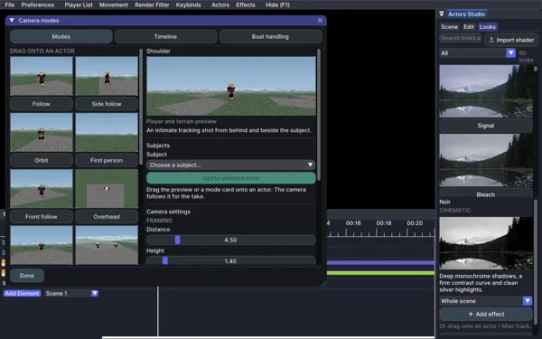

# Camera modes

Open **Actors > Camera modes**. Boat Cam is now a general camera mode library
for actors on foot or in vehicles. Existing saved boat camera clips keep working.

## Drag a mode onto an actor

1. Pick a mode card in the **Modes** tab.
2. Drag its thumbnail, name or large preview onto an actor's timeline row.
3. A camera clip is created in **Camera modes**, following that actor for its
   take, including its offset and trim range.

You can also select an actor and choose **Add to selected actor**. Both the actor
track and the Camera modes track must be unlocked. Adding, moving, trimming,
muting, duplicating and deleting clips support editor undo/redo.

The preview uses a fully skinned Minecraft player with a travel-matched walking
stride on grass and a stone path, using Minecraft textures and the actual camera
math. Directional lighting, soft ground shadows and distance haze give the scene
depth, while adaptive texture subdivision reduces perspective stretching.
It updates with the mode and camera tuning without moving the replay camera.
It is a composition preview, not a live view of the replay world.

## Modes

- **Follow** follows the subject from behind.
- **Side follow** tracks beside the subject.
- **Orbit** circles the subject using replay time, independently of its body turns.
- **First person** looks forward from the subject's eye level.
- **Front follow** looks back from ahead of the subject.
- **Overhead** gives a stable north-up view of its path.
- **Drift follow** follows travel direction through turns and slides.
- **Two subjects** frames a pair. Choose a different **Second subject** before
  dropping this mode onto the first actor. Both must share a dimension.

Adjust distance, height, FOV and smoothing under **Camera tuning**. **Fine tune**
contains look ahead, side offset, orbit speed, speed zoom and banking. Obstacle
avoidance can pull the camera closer, which may crop one of two subjects.
**Live follow** can temporarily follow the chosen subject outside a camera clip.
Closing the library does not stop an active live follow camera.

## Cinematic shots

- **Shoulder** follows close behind with a sideways offset for intimate framing.
- **Low angle** tracks near the ground and looks up at the subject.
- **Crane reveal** rises and widens to expose the surrounding scene.
- **Push in** eases closer to the subject.
- **Pull back** eases away and rises to reveal the surroundings.
- **Dolly zoom** moves back while narrowing the field of view to keep the
  subject approximately the same size as the background perspective changes.

Crane reveal, Push in, Pull back and Dolly zoom move over the first eight seconds
of each camera clip, then hold. Shorter clips use the opening part of the move.
Distance and height set their framing range. Scrubbing and export use the same
clip-local time. Live follow uses replay time. Obstacle avoidance can change the
composition, including the size compensation of a dolly zoom.

## Timeline and export

Camera clips contribute to Flashback's inferred export range, including projects
without native camera keys. Explicit export In / Out values still take precedence.
Trimmed exports use absolute replay time so camera clips and actor sampling stay
aligned, and Flashback's accurate camera transforms consume the active shot.

Camera clips activate as the playhead enters them and release control at their
exclusive end tick. Preview playback and export use the same fractional clock.
Drag a clip to move it, drag its edges to trim it, or double-click to edit.
Right-click a clip for edit, mute, duplicate or delete; right-click the row for
track mute, lock and delete. The clip with the latest start wins overlaps;
later-added clips win ties. Normal Flashback camera tracks resume outside clips.

The **Timeline** tab also accepts exact times and the export In / Out range.
Each clip saves its mode, tuning and subjects per replay in `boat-studio.json`.
This legacy file name stays unchanged to preserve existing projects. No baking
or native Camera/FOV key generation is needed.

## Boat handling

**Boat handling** contains the actor boat settings. The same controls are available in
**Actors > Settings > Camera & boats**:

- Propulsion scales thrust from recorded controls, preserving external impulses.
- Steering changes turning response.
- Lateral grip below 1 preserves sideways drift through native friction;
  above 1 adds sideways damping while grounded.
- Wall bounciness ranges from 0 (vanilla) to 1 (reflection without added speed).
- Paddle animation, stroke smoothing, older-take fallback and collision reactions
  can each be toggled.

Handling applies to simulated actor boats. A non-default handling setting releases
an actor boat from its recorded positions into physics using its saved controls.
Seek back to the take's beginning after changing handling. Reset vanilla handling
restores propulsion, steering and grip to 1 and bounciness to 0.

World settings control local native redstone/fluid/block entity simulation
and environmental movement reactions. Sulfur geysers use the installed game's
native implementation, so they are available only in versions containing them.
Elytra and attached firework simulation can be toggled under Playback.

Each mode starts with its own recommended distance, height, FOV and smoothing.
Use **Recommended framing** under Camera tuning to restore those settings.

