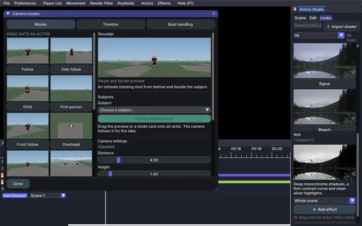

# Flashback Actors

Record actors inside a Flashback replay, then direct their performance on the timeline. Use camera clips, morphs, skins and looks without recording the take again.

These guides cover **0.11.1**, currently a release candidate. The [changelog](Guide-changelog) records what changed; the [test log](Test-log) includes successful runs, earlier failures and screenshots.

## Start here

1. [Download your Minecraft build](Guide-downloads), then [install it](Guide-install) with Flashback and Fabric API.
2. [Record your first take](Guide-takes). Set up the actor, perform, then stop recording.
3. [Add a camera mode](Guide-camera-modes) and [export the scene](Guide-export).

## Direct the scene

[Camera modes](Guide-camera-modes) adds fourteen shot presets, from Follow and Orbit to Crane reveal and Dolly zoom. Drag a preset onto an actor, then move or trim the camera clip.

[Timeline editing](Guide-timeline) covers arranging takes, working with clips and protecting tracks with locks. [Actors Studio](Guide-studio) keeps scene, editing and looks controls in a dockable panel.

## Change the cast

Use the [Morph library](Guide-morphs) to choose a body and pose, [Skin studio](Guide-skins) to apply a skin, and [gear or emotes](Guide-gear-emotes) to dress and animate an actor.

[Custom models](Guide-custom-mobs) can use supported Blockbench/GeckoLib geometry and animations. Supported living entities from installed mods can also appear in the morph picker.

## Finish the shot

Add [Looks and effects](Guide-looks), write [captions](Guide-captions), or enable [voice recording](Guide-voice). [Settings and UI themes](Guide-settings) control recording, playback and the editor's appearance.

If something fails, start with [troubleshooting](Guide-troubleshooting). Saved test results and their limits are available in the [test log](Test-log).

