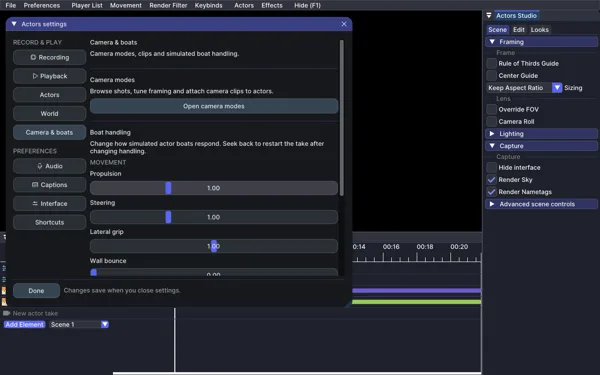
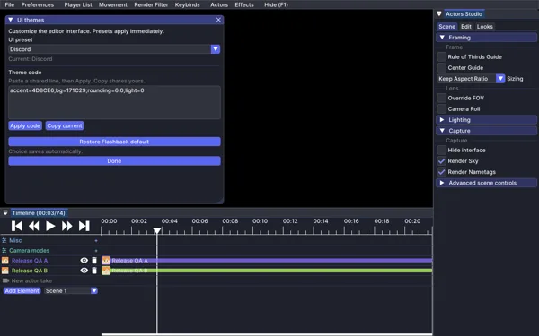

# Settings and UI themes

Settings is organized into Recording, Playback, Actors, World, Camera & boats,
Audio, Captions, Interface and Shortcuts. Recording covers countdown, take length
and end-of-run behavior. Playback covers movement quality, elytra and momentum;
Actors contains combat and morph preferences. World controls local simulation,
viewport blocks and terrain reactions. Camera & boats includes boat handling
controls and a shortcut to camera modes. Captions groups text styling,
background, placement and timing. Interface contains themes and editor panels;
Shortcuts contains keyboard preferences. The window can be resized, and narrow
layouts use a page picker instead of the sidebar.

## UI themes

Open **Actors > UI themes**, or use **Interface > UI themes** in Settings. Choose an editor preset, use a custom theme code, or reset to the default. Theme changes affect the interface. Use [Looks](Guide-looks) to grade rendered scene content.

## Shortcuts

Change rebindable keys in **Minecraft Settings > Controls > Flashback Actors**. The Settings Shortcuts page controls keyboard preferences.

