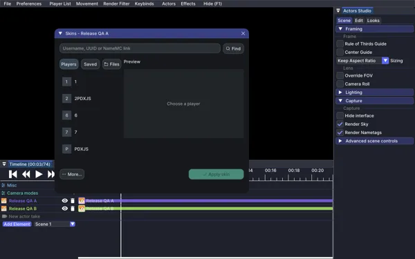

# Choosing actor skins

Open an actor's **Change skin** window to show **Skin studio**. Enter a Minecraft
username, dashed or undashed UUID, or a NameMC player profile link. Select
**Find** (or press Enter), check the full-body 3D preview, then **Apply skin**.
Drag the preview to turn it, use **Front** or **Back**, or enable **Walk** to see
it in motion. The Apply button stays below the panels. This uses the account's
current skin. **More → Browse NameMC** opens your browser; copy a player profile
link back into the picker to use that account without downloading a PNG.

**Players** lists real players in the replay, excluding the replay camera and
actor clones. **Saved** shows your saved account skins. The search field filters
both lists; Find also searches for accounts outside the replay. **Save skin**
keeps an online result for later. **Files** retains PNG imports, with arm model
selection and local capes under **Cape & arms**. **More → Restore default** restores
the actor's original skin. Unlock a locked actor track before changing it.

The library and preview sit beside each other in a wide window and stack in
narrow docks. Preview players use a separate renderer and never enter the world.
Their outer skin layers and slim/classic model come from the selected skin.

Network requests run outside the render thread with a bounded queue and a
30-second overall timeout. Editing the query, changing actors or closing the
picker cancels the previous search. Results only change an actor when you
press Apply. Invalid input and failed requests display an error in the picker.

