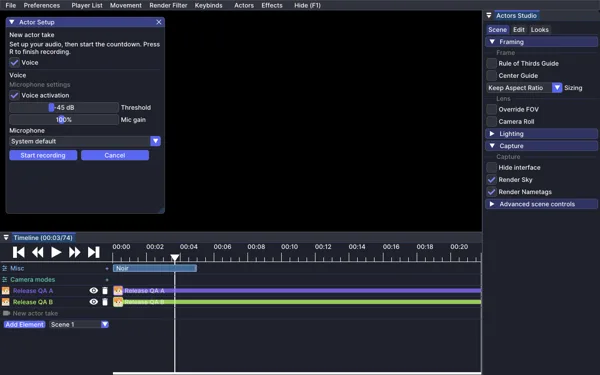

# Record a take

A take stores an actor's performance at replay ticks. Earlier actors keep playing while you record the next one, so a scene can be built in separate passes.

## Set up the actor

1. Open a replay in Flashback and move the playhead to the actor's entrance.
2. Press **R**, or use **New actor take** on the timeline, to open setup.
3. Choose the actor options. Enable microphone recording here if you want voice.
4. Start recording and wait for the countdown before performing.

## Perform and stop

Movement, pose, held items, item use and interactions are recorded. Block changes and vehicle rides are part of the performance too. Creative preparation can include building and placing vehicles before the countdown; those scene edits are included at the start of the take.

Use **Stop recording** to finish early. If **Escape finishes at end** is enabled, Escape can finish at the end of the footage when no other screen is open. Closing an inventory does not end the run.

You return to the editor camera and the take's starting playhead. See [timeline editing](Guide-timeline) to arrange or trim the result.

## What is recorded

| Part | Recorded data |
|---|---|
| Body | Position, rotation, pose, sneaking, sprinting, ground state, elytra and swings |
| Items | Held stacks, hotbar selection and item use |
| Combat | Strikes, damage, knockback, critical flags, health, absorption, effects and arrows |
| World | Block changes, block-entity data, containers and performer-caused sounds |
| Vehicles | Mounts, dismounts and supported vehicle state |
| Voice | Optional microphone audio, when enabled |

## Where takes are saved

Takes are saved per replay under `flashback/fbactors/<replay-uuid>/`. They are separate from the replay recording. Keep that folder when backing up a scene.

Use [sharing and storage](Guide-sharing) when moving a cast to another installation. Take format history is recorded in the [changelog](Guide-changelog); older builds can refuse files written by a newer format.

