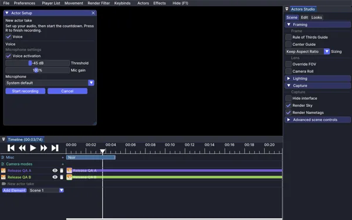

# Voice recording

Microphone capture is optional and configured while setting up an actor take. Recording game sounds does not require microphone capture.

## Set up the microphone

1. Open **Actor setup** before recording.
2. Enable **Voice** and choose the input device.
3. Adjust gain and the voice-activation threshold.
4. Record a short test take and listen to the result before a long performance.

## Playback and captions

Voice is associated with the actor's take. [Captions](Guide-captions) are edited separately and can describe dialogue or other information at specific times.

If the microphone is unavailable, check the selected input device and the operating system's permissions. A device appearing in a list does not prove that it captured audible input.

The release harness never records physical microphone input. Physical capture and audible playback remain hands-on checks; see the [test log](Test-log).

