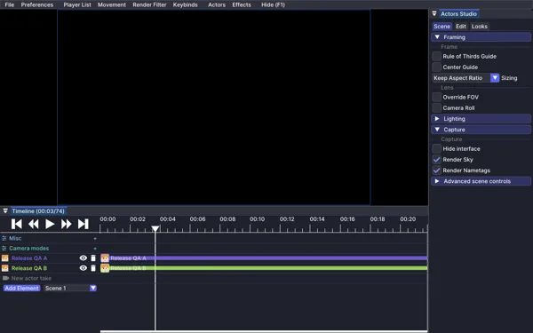
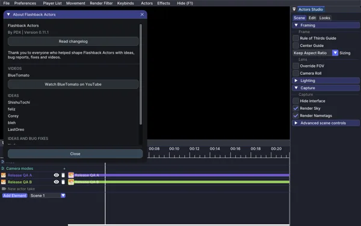
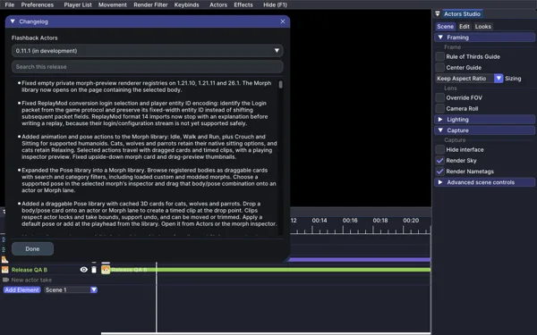

# Flashback Actors test log

0.11.1: **9/9 clients passed**, 4,644 unit tests and 8 GPU tests in the latest matrix.

The history retains 77 records, including 20 failed or errored attempts. Older individual test XML was overwritten; the test inventory is the latest saved XML.

[[Failed attempts|Failures]] · [[Screenshots|Images]] · [[Verified fixes|Updates]] · [[Individual tests|Tests]]

[Interactive test log](https://pdx122.github.io/Actors/test-log/)

## Saved runs and builds

| UTC | Result | Record | Batch |
|---|---|---|---|
| 2026-11-02T06:13:20 | PASSED | Unit tests / 26.3 | JUnit XML |
| 2026-11-02T06:13:09 | PASSED | Unit tests / 26.2 | JUnit XML |
| 2026-11-02T06:12:57 | PASSED | Unit tests / 26.1.2 | JUnit XML |
| 2026-11-02T06:12:44 | PASSED | Unit tests / 1.21.8 | JUnit XML |
| 2026-11-02T06:12:33 | PASSED | Unit tests / 1.21.5 | JUnit XML |
| 2026-11-02T06:12:21 | PASSED | Unit tests / 1.21.4 | JUnit XML |
| 2026-11-02T06:12:08 | PASSED | Unit tests / 1.21.11 | JUnit XML |
| 2026-11-02T06:11:52 | PASSED | Unit tests / 1.21.10 | JUnit XML |
| 2026-11-02T06:11:37 | PASSED | Unit tests / 1.21.1 | JUnit XML |
| 2026-11-02T06:09:17 | PASSED | Client run / 26.3 | morph-isolation-final |
| 2026-11-02T06:07:42 | ERROR | Client run / 26.3 | morph-isolation-world |
| 2026-11-02T06:07:00 | PASSED | Client run / 26.2 | morph-isolation-world |
| 2026-11-02T06:05:16 | PASSED | Client run / 26.2 | morph-isolation-2 |
| 2026-11-02T06:05:01 | PASSED | Client run / 26.3 | morph-isolation-2 |
| 2026-11-02T06:02:58 | ERROR | Client run / 26.3 | morph-isolation |
| 2026-11-02T06:02:29 | ERROR | Client run / 26.2 | morph-isolation |
| 2026-11-02T04:16:19 | PASSED | Release validation complete | release-validation-complete.log |
| 2026-11-02T04:16:19 | PASSED | Native GPU tests / 26.3 | JUnit XML |
| 2026-11-02T04:16:16 | PASSED | OpenGL tests / 1.21.11 | JUnit XML |
| 2026-11-02T04:15:34 | PASSED | Export boundary check / 1.21.1 | export-boundary-final |
| 2026-11-02T04:15:34 | FIXED | Camera exports keep the final tick | export-boundary-final |
| 2026-11-02T04:14:58 | PASSED | Export boundary check / 26.2 | export-boundary-final |
| 2026-11-02T04:14:51 | PASSED | Export boundary check / 26.3 | export-boundary-final |
| 2026-11-02T04:13:27 | FAILED | Release validation final | release-validation-final.log |
| 2026-11-02T04:08:00 | PASSED | Release validation | release-validation.log |
| 2026-11-02T04:06:06 | PASSED | ReplayMod import / 26.2 | conversion-final-2 |
| 2026-11-02T04:06:06 | FIXED | ReplayMod conversion completed the full harness | conversion-final-2 |
| 2026-11-02T04:03:30 | PASSED | Production final build | production-final-build.log |
| 2026-11-02T04:02:23 | FAILED | ReplayMod import / 26.2 | conversion-final |
| 2026-11-02T04:01:05 | PASSED | ReplayMod import / 26.2 | conversion-check-5 |
| 2026-11-02T03:57:19 | ERROR | ReplayMod import / 26.2 | conversion-check-4 |
| 2026-11-02T03:55:15 | ERROR | ReplayMod import / 26.2 | conversion-check-3 |
| 2026-11-02T03:51:37 | PASSED | Conversion tests | conversion-tests.log |
| 2026-11-02T03:51:19 | FAILED | ReplayMod import / 26.2 | conversion-check-2 |
| 2026-11-02T03:45:23 | ERROR | ReplayMod import / 26.2 | conversion-check |
| 2026-11-02T03:45:01 | PASSED | Client run / 1.21.8 | render-repair |
| 2026-11-02T03:45:01 | FIXED | Timeline mutation and preview state fixes verified | render-repair |
| 2026-11-02T03:44:32 | PASSED | Client run / 26.2 | render-repair |
| 2026-11-02T03:43:41 | PASSED | Production final verification | production-final-verification.log |
| 2026-11-02T03:40:18 | PASSED | Client run / 26.3 | production-check-3 |
| 2026-11-02T03:40:18 | FIXED | Parallel client isolation repaired | production-check-3 |
| 2026-11-02T03:38:40 | FAILED | Client run / 26.2 | production-check-3 |
| 2026-11-02T03:35:04 | PASSED | Client run / 26.1.2 | production-check-3 |
| 2026-11-02T03:34:08 | PASSED | Client run / 1.21.11 | production-check-3 |
| 2026-11-02T03:33:46 | PASSED | Client run / 1.21.10 | production-check-3 |
| 2026-11-02T03:31:17 | ERROR | Client run / 1.21.8 | production-check-3 |
| 2026-11-02T03:29:48 | PASSED | Client run / 1.21.4 | production-check-3 |
| 2026-11-02T03:29:46 | PASSED | Client run / 1.21.1 | production-check-3 |
| 2026-11-02T03:29:18 | PASSED | Client run / 1.21.5 | production-check-3 |
| 2026-11-02T03:23:49 | PASSED | Client run / 26.3 | production-check-2 |
| 2026-11-02T03:22:49 | FAILED | Client run / 26.2 | production-check-2 |
| 2026-11-02T03:21:17 | PASSED | Client run / 1.21.11 | production-check-2 |
| 2026-11-02T03:20:03 | PASSED | Production verification | production-verification.log |
| 2026-11-02T03:19:50 | PASSED | Client run / 26.1.2 | production-check-2 |
| 2026-11-02T03:19:12 | FAILED | Client run / 1.21.8 | production-check-2 |
| 2026-11-02T03:16:08 | ERROR | Client run / 1.21.10 | production-check-2 |
| 2026-11-02T03:16:06 | FAILED | Client run / 1.21.1 | production-check-2 |
| 2026-11-02T03:15:42 | FAILED | Client run / 1.21.4 | production-check-2 |
| 2026-11-02T03:14:45 | FAILED | Client run / 1.21.5 | production-check-2 |
| 2026-11-02T03:08:44 | PASSED | Conversion state tests | conversion-state-tests.log |
| 2026-11-02T03:08:06 | PASSED | Client run / 1.21.1 | capture-repair |
| 2026-11-02T03:07:42 | PASSED | Client run / 26.1.2 | capture-repair |
| 2026-11-02T03:07:40 | PASSED | Client run / 26.2 | capture-repair |
| 2026-11-02T02:51:59 | FAILED | Client run / 26.2 | release-qa |
| 2026-11-02T02:50:29 | PASSED | Client run / 1.21.1 | release-qa |
| 2026-11-02T02:48:49 | ERROR | Client run / 1.21.11 | release-qa |
| 2026-11-02T02:48:43 | FAILED | Client run / 1.21.5 | release-qa |
| 2026-11-02T02:47:56 | PASSED | Client run / 26.3 | release-qa |
| 2026-11-01T08:27:39 | PASSED | Client run / 1.21.11 | release-qa |
| 2026-11-01T08:24:47 | PASSED | Client run / 1.21.10 | release-qa |
| 2026-11-01T08:21:53 | PASSED | Client run / 1.21.8 | release-qa |
| 2026-11-01T08:19:06 | PASSED | Client run / 1.21.5 | release-qa |
| 2026-11-01T08:16:14 | PASSED | Client run / 1.21.4 | release-qa |
| 2026-11-01T08:13:31 | PASSED | Client run / 1.21.1 | release-qa |
| 2026-11-01T08:13:06 | PASSED | Client run / 26.2 | release-qa |
| 2026-11-01T08:10:17 | PASSED | Client run / 26.3 | release-qa |
| 2026-11-01T08:07:51 | PASSED | Client run / 26.1.2 | release-qa |

## Coverage limits

- Physical microphone capture and audible playback
- Authenticated online skin-service requests
- Mouse drag and keyboard interactions end to end
- Arbitrary third-party mods, models and shaders
